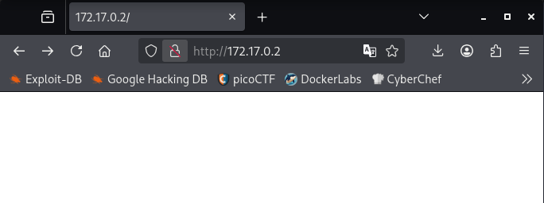
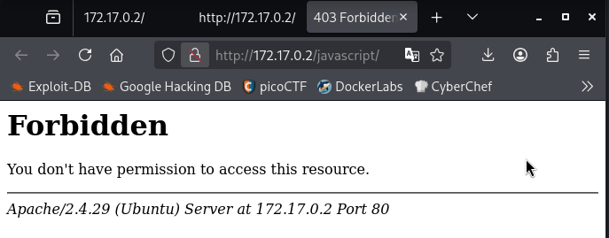
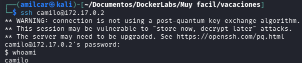
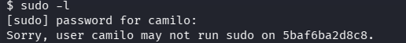
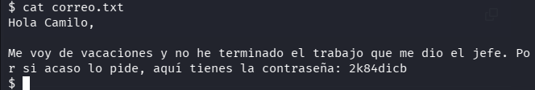
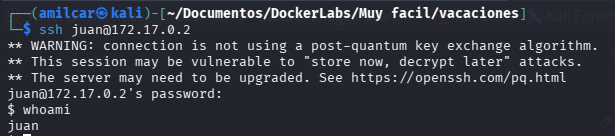
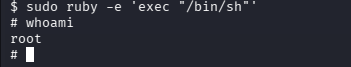

# Vacaciones

**Nivel:** Muy fácil  
**Autor:** Amilcarqs  
**Laboratorio:** Vacaciones

## Objetivo

Enumerar los servicios disponibles, analizar las pistas expuestas por el sitio web, acceder a las cuentas implicadas y comprobar la escalada de privilegios dentro del laboratorio autorizado.

> Realiza estos pasos únicamente contra la instancia local del laboratorio. La dirección `172.17.0.2` corresponde al entorno mostrado en esta práctica; no la uses como objetivo fuera de ese entorno.

## Requisitos

- Instancia de Docker Labs iniciada.
- Una terminal en la máquina de trabajo y un navegador.
- Herramientas de enumeración instaladas, como Nmap y Dirsearch.

## Solución paso a paso

### 1. Iniciar el laboratorio

Desde el directorio que contiene el script y el archivo del laboratorio, iniciar la instancia con el procedimiento indicado por Docker Labs. En esta práctica se utilizó:

```bash
sudo bash auto_deploy.sh vacaciones.tar
```


Anota la dirección IP asignada; en las evidencias de esta ejecución fue `172.17.0.2`.

### 2. Enumerar los servicios

Realiza un escaneo de servicios y versiones sobre la IP del laboratorio:

```bash
nmap -sC -sV 172.17.0.2
```

Se identificaron estos puertos:

- `22/tcp`: SSH, OpenSSH 7.6p1 en Ubuntu.
- `80/tcp`: HTTP, Apache 2.4.29 en Ubuntu.

El servicio web no mostraba contenido visible ni un título HTML. 


Aun así, conviene revisar tanto la página como su código fuente: el HTML contenía un comentario que mencionaba a **Juan** y **Camilo**, además de indicar que había un correo importante.


### 3. Revisar las rutas web
Revisamos mas el sitio con escaneos con dirsearch:
Se puede hacer una enumeración de contenido para buscar rutas accesibles. En este caso se encontró `/javascript/`, pero al visitarla el servidor respondió `403 Forbidden`. No se identificaron otras páginas útiles en esta etapa.


Un código `403` indica que el servidor deniega el acceso a esa ruta; por sí solo no demuestra que exista una vulnerabilidad.


### 4. Relacionar las pistas con las cuentas

Pasamos a revisar el puerto 22 probando con los usuarios que encontramos en la linea comentada: Juan y Camilo

Al no tener la contraseña probaremos con fuerza bruta, y probaremos Camilo porque la linea comentada dice 'De : Juan Para: Camilo ', entonces camilo puede tener el correo recibido.


Obtenemos el password y probamos en ssh logrando acceder con el usuario camilo



### 5. Examinar los archivos disponibles para Camilo

Una vez dentro como Camilo, comprueba los permisos de `sudo` y revisa los archivos accesibles relacionados con las pistas:

```bash
sudo -l
ls -la /var/mail
ls -la /var/mail/camilo
cat /var/mail/camilo/correo.txt
```


Camilo no tenía permisos para ejecutar comandos con `sudo`. 

Sin embargo, el correo en `/var/mail/camilo/correo.txt` contenía una pista que permitía autenticar una sesión SSH como **Juan**. 



### 6. Revisar los permisos de Juan
Accedemos con el usuario juan :

Con acceso a la cuenta de Juan, consulta la configuración de `sudo`:

```bash
sudo -l
```

La salida mostraba que Juan podía ejecutar `/usr/bin/ruby` como `root` sin solicitar contraseña. La autorización de un intérprete de propósito general con privilegios elevados permite ejecutar acciones como administrador y debe considerarse una configuración insegura.

En el laboratorio, utiliza esa autorización para demostrar la escalada de privilegios y confirma el resultado con:

```bash
whoami
```

La comprobación final devuelve `root`. No ejecutes esta técnica fuera de la instancia autorizada.

## Resultado

Se completó la cadena de acceso del laboratorio: las pistas del sitio condujeron a las cuentas de Camilo y Juan; el correo local permitió avanzar de una cuenta a la otra; y la regla de `sudo` asignada a Juan permitió validar el acceso como `root`.

## Observaciones de seguridad

- No expongas servicios SSH ni credenciales débiles innecesariamente.
- No guardes contraseñas en correos legibles por otros usuarios; protege los buzones y usa mecanismos seguros de gestión de secretos.
- Limita las reglas de `sudo` a ejecutables y argumentos estrictamente necesarios. Evita conceder permisos privilegiados sobre intérpretes como Ruby.
- Al entregar la práctica, adjunta capturas tomadas en tu entorno y oculta cualquier contraseña o dato que no sea necesario para la validación.
